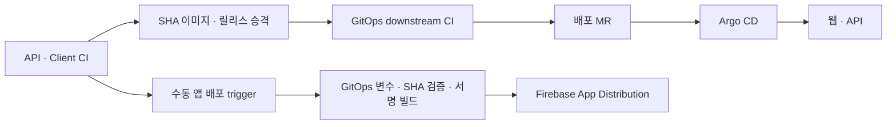

# Q 인테리어 운영 연결

## 구조

기준일: 2026-10-09. `atmo-api`, `atmo-web`, 본 저장소의 기존 CI·ApplicationSet·Sealed Secrets 구성을 읽고 확장한 초기 구현입니다.

- `q-interior-api`: Spring Boot + Kotlin API, Container Registry 이미지.
- `q-interior-client`: KMP·Compose 웹·Android·iOS, 웹만 컨테이너 이미지.
- 본 저장소: CI 템플릿, 웹·API overlay, 시크릿 sealing, 앱 서명·Firebase 배포.

Firebase는 tester 배포입니다. Play Store/App Store 정식 출시는 별도 흐름이며 현재 구현했다고 간주하지 않습니다. Argo CD는 앱 배포를 실행하지 않습니다. 앱을 Kubernetes Job으로 만들면 Runner와 별도로 SDK·서명 환경을 관리해야 하므로 중앙 GitLab CI를 기본으로 선택했습니다.

## 운영 경로

API 공개 경로는 `/q-interior/api/v1`, 서버 내부 경로는 `/api/v1`입니다. 웹 공개 경로는 `/q-interior/`입니다. Traefik이 `/q-interior`를 제거하고 각 서비스로 보냅니다. Cookie path는 공개 API 경로와 일치합니다.

overlay는 `workloads/q-interior/{api,web}/environments/{dev,prod}`입니다. 기존 ApplicationSet이 자동 발견하므로 별도 앱 ApplicationSet을 만들지 않습니다. 기존 atmo와 동일하게 dev는 ingress 없이 port-forward 중심, prod는 path ingress를 준비했습니다. 실제 host는 기존 Traefik 진입점을 사용하며 새 도메인을 임의로 지정하지 않습니다.

초기 replicas는 **0**입니다. Registry secret·DB secret이 비어 있는 overlay를 실제 운영 완료로 간주하지 않습니다. 첫 배포 명령은 필요한 암호화 secret과 Neon host를 검사한 뒤 image tag 및 replicas를 바꾸는 MR을 만듭니다. 배포 MR을 병합해야 Argo CD가 실제 반영합니다.

## 본 저장소에 설정할 변수

실제 값을 문서나 채팅에 넣지 않습니다. 아래는 이름과 전달 계약입니다.

| 이름 | 형태 | 사용처 |
| --- | --- | --- |
| `Q_INTERIOR_API_DEV_ENV` / `Q_INTERIOR_API_PROD_ENV` | File, protected | datasource URL·username·password를 kubeseal로 암호화 |
| `Q_INTERIOR_NEON_DEV_HOST` / `Q_INTERIOR_NEON_PROD_HOST` | 일반 공개 hostname, protected | 환경별 Cilium DNS·5432 egress |
| 기존 `SEALED_SECRETS_CERT` | File | Sealed Secrets 공개 인증서 |
| 기존 `GITLAB_REGISTRY_USERNAME/TOKEN` | masked/protected | 두 이미지 저장소 읽기용 registry secret |
| `Q_INTERIOR_API_URL` | 공개 설정, protected | Android/iOS 빌드 시 API URL, `/q-interior/api/v1` 포함 |
| `Q_INTERIOR_ANDROID_KEYSTORE` | File, protected | Android signing keystore |
| `Q_INTERIOR_ANDROID_STORE_PASSWORD`, `Q_INTERIOR_ANDROID_KEY_ALIAS`, `Q_INTERIOR_ANDROID_KEY_PASSWORD` | masked/protected | signing credentials |
| `Q_INTERIOR_FIREBASE_CREDENTIALS` | File, protected | 제한된 App Distribution 권한의 서비스 계정 JSON |
| `Q_INTERIOR_FIREBASE_ANDROID_APP_ID`, `Q_INTERIOR_FIREBASE_IOS_APP_ID` | 일반 설정, protected | Firebase에 등록된 앱 ID |
| `Q_INTERIOR_FIREBASE_GROUPS` | 일반 설정, protected | tester group alias |
| `Q_INTERIOR_IOS_P12`, `Q_INTERIOR_IOS_PROFILE`, `Q_INTERIOR_IOS_EXPORT_OPTIONS` | File, protected | 인증서·profile·exportOptions.plist |
| `Q_INTERIOR_IOS_P12_PASSWORD` | masked/protected | P12 비밀번호 |
| `Q_INTERIOR_IOS_TEAM_ID` | 일반 설정, protected | Apple Developer 팀 |

API File 변수 필수 항목은 `SPRING_DATASOURCE_URL`, `SPRING_DATASOURCE_USERNAME`, `SPRING_DATASOURCE_PASSWORD`입니다. URL은 JDBC 형식과 SSL 검증을 사용합니다. 시크릿은 기존 sealing job이 암호화해 생성하며 실제 env 파일은 Git에 들어가지 않습니다. Q 인테리어 변수가 없으면 기존 서비스 sealing 동작을 유지합니다.

모바일 변수는 가능하면 `q-interior-mobile-dev` 환경으로 scope를 제한하고 protected main에서만 사용합니다. 루트 pipeline 입력은 action·dev/prod·source ref·source SHA이며 원본 pipeline 변수를 forward하지 않습니다. GitOps 측의 환경 변수가 기준입니다.

## GitLab 설정 선행 조건

1. 그룹에 두 소스 저장소를 생성하고 `main`을 보호합니다. 저장소 권한과 source main 리뷰는 중앙 signing CI가 실행하는 코드를 보호하는 기준입니다.
2. 본 저장소 CI include와 downstream 입력 기능을 먼저 병합합니다. 소스 CI는 해당 템플릿이 main에 있어야 시작할 수 있습니다.
3. 두 소스 프로젝트의 CI_JOB_TOKEN allowlist에 본 GitOps 프로젝트를 추가합니다. GitOps가 소스를 읽어 고정 SHA를 확인하기 위한 권한입니다.
4. 본 프로젝트가 source 프로젝트의 multi-project trigger를 허용하고, 본 프로젝트의 CI_JOB_TOKEN repository push 기능이 켜져 있는지 확인합니다. 기존 sealing push와 동일한 방식입니다.
5. Registry read token이 새 API·Client 이미지도 읽을 수 있는지 확인합니다. 기존 토큰 값은 코드로 복사하지 않습니다.
6. variables를 본 저장소에서 설정한 뒤 기존 수동 `update_secrets=true` sealing job을 실행합니다.
7. main 이미지 빌드가 성공한 뒤 deploy downstream이 만드는 MR을 검토·병합합니다. prod는 동일 SHA에 대한 `vX.Y.Z` 승격 이미지로 배포합니다.

원격 변수 생성·권한 변경·production 배포는 이 로컬 작업에서 수행하지 않았습니다. GitLab 저장소가 public인 기존 운영 형태를 새 소스 저장소에 자동 적용하지 않습니다.

## 회원 인증 메일 설정

API env File 변수에 `Q_INTERIOR_SMTP_HOST`, `Q_INTERIOR_SMTP_USERNAME`, `Q_INTERIOR_SMTP_PASSWORD`, `Q_INTERIOR_MAIL_FROM`, `Q_INTERIOR_PUBLIC_WEB_URL`을 추가합니다. 기존 envFrom·SealedSecret 구조를 그대로 사용하며 값을 소스 저장소에 넣지 않습니다.

SMTP는 587 STARTTLS 필수·서버 인증서 hostname 검증을 사용합니다. 메일 서버 DNS 정책에는 GitOps 공개 변수 `Q_INTERIOR_SMTP_DEV_HOST` / `Q_INTERIOR_SMTP_PROD_HOST`를 설정합니다. env File의 SMTP_HOST와 일치해야 합니다. 배포 MR이 정확한 DNS hostname과 587 포트만 허용하며 기본값은 미설정 placeholder입니다.

`Q_INTERIOR_PUBLIC_WEB_URL`은 HTTPS 웹 진입점 전체 주소입니다. 인증 토큰은 URL fragment `#verify=`에 담고, 웹은 읽은 뒤 주소에서 제거합니다. 운영 로그에 토큰·메일 본문·SMTP 비밀번호를 기록하지 않습니다.

`Q_INTERIOR_REGISTRATION_ENABLED`는 기본 false입니다. 현재 동의 문서는 검토용 초안이므로 정식 문서 확정·메일 실수신 테스트·가입/로그인 abuse 방어·발송 실패 모니터링을 완료하기 전에 운영 가입을 활성화하지 않습니다. `local` 프로필과 개발용 메일함은 운영 manifest에 사용하지 않습니다.

## 모바일 Runner 준비

Android job은 Android SDK 35 이미지·Java 17·Node/Firebase CLI를 사용합니다. 서명 key가 없으면 unsigned 앱을 배포하는 대신 job이 실패합니다. APK artifact나 signing key를 공개 pipeline artifact로 올리지 않습니다.

iOS는 `macos`, `q-interior` 태그의 전용 macOS Runner가 필요합니다. Java 17, Xcode, XcodeGen, Node, Firebase CLI를 준비하고 저장소 main에 대한 untrusted job이 이 Runner를 사용하지 못하게 설정합니다. 임시 keychain·profile은 job 종료 시 제거합니다. 사용 중인 Runner profile 파일을 덮어쓰지 않습니다. 최초 IPA 실빌드·서명·Firebase 수신 테스트는 해당 Runner에서 별도 확인해야 합니다.

`distribute_android`·`distribute_ios`는 Client CI의 수동 작업입니다. 앱은 GitOps가 제공된 ref를 가져와 실제 commit SHA와 비교한 뒤 빌드합니다. main이 그 사이 변경됐으면 오래된 source를 배포하지 않고 최신 pipeline 실행을 안내합니다. 현재 mobile은 dev만 허용합니다.

## 검증·미완료

새 YAML·shell·Kustomize 렌더링과 API/웹 빌드는 로컬 검증 대상으로 삼습니다. 실제 GitLab pipeline, registry push, Argo sync, Neon 연결, APK/IPA 서명, Firebase 업로드는 계정·변수·Runner 준비 뒤 확인해야 합니다.

현재 API는 초기 회원·웹 세션·초안 기능만 제공합니다. 이메일 인증·약관 동의·역할 검증·계약·결제 등의 출시 필수 기능이 미완료이므로 운영 ingress와 secret 준비가 곧 서비스 출시를 의미하지 않습니다.

참고: [Firebase CLI tester 배포](https://firebase.google.com/docs/app-distribution/android/distribute-cli), [GitLab downstream pipelines](https://docs.gitlab.com/ci/pipelines/downstream_pipelines/).
